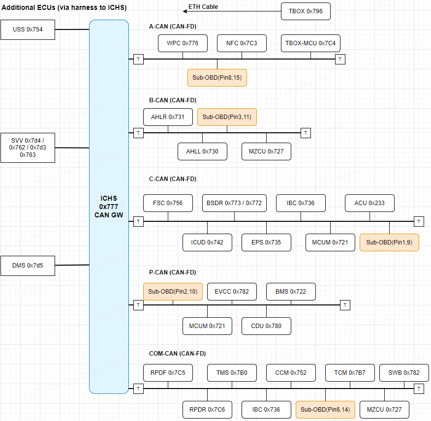

Write the opening paragraph here. It should explain the problem or the point of the article in two or three sentences.

## First section heading

Body text. You can use **bold**, *italic*, [links](https://example.com), `inline code`, and lists:

- Bullet one
- Bullet two

## Images

Images live in the `/images/` folder at the repository root. Reference them with an absolute path:

```markdown

```

## Code blocks

```python
# This is a Python code block
print("hello")
```

## Blockquotes

> A short pull quote or important caveat.

## Publishing checklist

1. Save this file as `my-article.md` in the same folder.
2. Open `posts.json` in the same folder and add one entry pointing to `my-article.md`.
3. Commit and push — GitHub Pages will pick it up within a minute.
