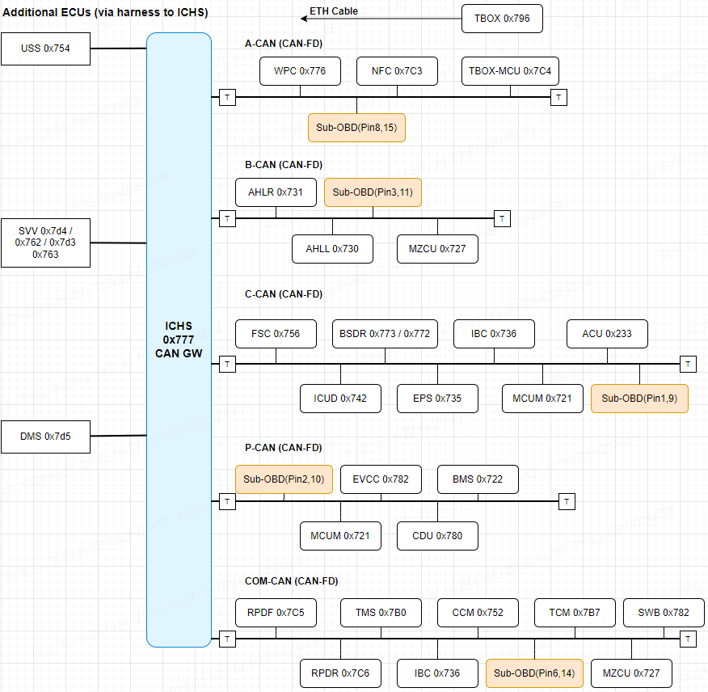

Most CAN debugging goes wrong at the topology stage, not the protocol stage.

## Reading the diagram

A vehicle CAN topology is not a bus — it is a set of segments joined by gateways, each with
its own termination and its own failure domain.

## Tracing a signal

Pick a signal and follow it end to end:

1. Identify the originating ECU and which segment it sits on.
2. Note every gateway the frame crosses.
3. Check whether the frame is **repackaged** or **forwarded** — the difference matters when
   timestamps drift.

## Common trap

A gateway that forwards a frame with a fresh timestamp makes latency analysis meaningless.
Log at the segment where the frame originates.
